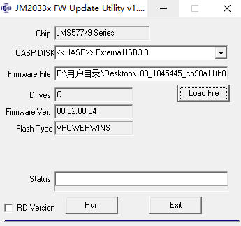
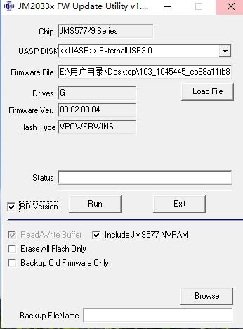
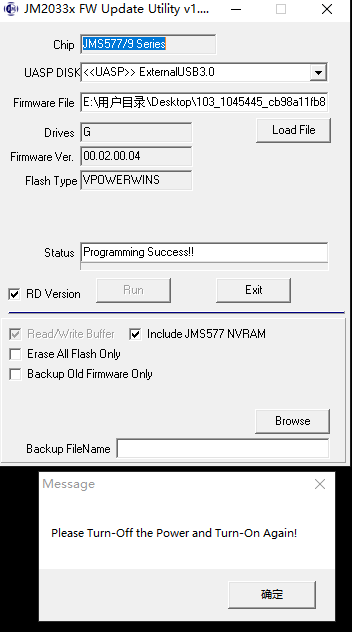
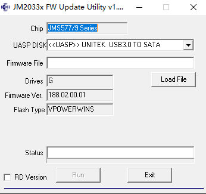

# jMicron-JMS578-Firmware
针对JMS578芯片的固件集合和刷机工具，可解决USB3&lt;->SATA接口存在的USB 3.0/1问题（如断开连接、读写异常等）。

## 固件说明

> 建议刷188.02.00.01。

JMicron官方188.02.00.01一共五大维度硬性升级，完美解决杂牌/ORICO盒子最普遍的痛点

一、UASP协议栈：根治握手降级、长时满载回落BOT（最核心提升）- 增加UAS多次重试握手机制，放宽SCSI REPORT LUNS超时阈值- 优化USB3.0数据包时序容错，主板XHCI控制器波动不会直接切断UAS链路- 高负载数据流拥塞时不会主动切回BOT，长时间挂机拷贝几十GB文件全程锁定UAS> 实测表现：普通3块钱杂牌USB‑C短线、带屏蔽劣质长线，都能稳定维持UAS识别


二、VBUS供电链路优化（绿联1.0.15主打修复）1. 旧固件问题：USB口电压瞬间跌落、插拔瞬间浪涌、笔记本USB口供电能力偏弱时，主控工作异常、断连、掉盘。很多ORICO透明盒满载掉盘就是这个原因。2. 188优化内容：- 增加VBUS电压采样滤波算法，抑制瞬时电压抖动误触发主控复位- 区分总线供电（2.5寸SSD盒）/外接供电SelfPower两套供电阈值，你这种普通移动盒刷BUS版188，供电匹配度拉满- 主控内部电源管理调压曲线更平缓，长时间满载主控温升更低、稳定性更好


三、TRIM指令完整透传 + SSD写入掉速问题修复1. 老固件现状：哪怕开了UASP，固件会拦截系统下发的TRIM命令，SSD无法自动垃圾回收，外置盘使用两三个月写入速度明显下跌、写入放大升高、SSD寿命损耗变大。部分固态全盘擦除后跑分无法恢复出厂水准。2. 188固件：原生直通Windows/macOS/Linux系统下发的TRIM指令，UASP模式下TRIM全程生效；不需要额外软件手动执行TRIM，外置SSD耐久、长期性能保持原厂状态。


四、系统休眠、唤醒、闲置功耗逻辑重做（原厂固件重灾区）1. 原厂默认固件通病：电脑睡眠后硬盘盒反复自动唤醒、疯狂闪灯；或者休眠后无法唤醒磁盘，必须重新拔插USB。闲置空载功耗偏高，笔记本外出耗电更快。188固件优化：
细化闲置分级休眠：空闲几秒进入主控低功耗、SSD 待机休眠，不会无故频繁唤醒系统休眠恢复后，UAS 链路平滑重建，不会出现磁盘脱机空载待机功耗下降，长期插电脑挂机更友好（适合 NAS、Home Assistant 挂载硬盘）

标准固件修订历史

## 使用办法

> 固件/参数更改后，需进行冷启动（HC1/HC2 电源循环）。  
> 在 HC1/HC2 模式下，若无硬盘或固态硬盘，则无法进行处理。必须连接 SATA 存储设备以更新固件。

### Windows

#### 备份

1.放入硬盘，然后插入至电脑usb口。
2.打开软件`FwUpdateTool_v1_19_16_24.exe`。



3.**勾选左下角 `RD Version`**（RD 就是调试模式，勾选后下方隐藏选项会显示出来）。
4.勾选弹出的附加选项里：**Backup Old Firmware Only（仅备份旧固件，不刷写）**。



5.`Backup FileName`点 Browse，设置保存路径，命名`jms578_orig_firmware_backup.bin`。
6.确认设备下拉框选中你的 `<<UASP>> ExternalUSB3.0`，Drives=G 不变。
7.点`Run`。
8.Status 栏出现：`Read flash and backup success!`，备份完成。

> 此时**只勾选 Backup Old Firmware Only，不要勾选 Erase All Flash**！

#### 更新固件

> 推荐刷入 `JMS578_188.02.00.01.bin`



1. 取消勾选`Backup Old Firmware Only`
2. 点击`Load File`，选中 `JMS578_188.02.00.01.bin`
3. 勾选 `Include JMS577 NVRAM`（界面出现这个选项就勾）
4. ❌ **不要勾选 Erase All Flash Only**
5. 点击`Run`，等待 `Update Success`
6. 退出工具，**拔掉硬盘盒 USB 断电 5 秒，重新插主板后置 USB3.0**


#### 校验刷写结果

重开工具，Firmware Ver 会从`00.02.00.04`变成`188.02.00.01`。


### Linux

> 固件更新需要ROOT权限

参数说明
```
-b   – 备份固件
-d   – 设备路径
-f   – 固件路径
-nNV – 无NVRAM更新. 此参数的优先级高于"-t"
-t   – 自动休眠（单位：分钟）
-v   – 显示软件版本或固件版本(配合-d参数使用)
-u   - 启用/禁用SATA热插拔功能。（适用于JMS578FwUpdate工具的2.00版本）
```

示例1 - 更新固件
```
root@odroid:~# ./JMS578FwUpdate -d /dev/sda -f ./JMS578-Hardkenel-Release-v173.01.00.02-20190306.bin -b ./backup.bin
Update Firmware file name: ./JMS578-Hardkenel-Release-v173.01.00.02-20190306.bin
Backup Firmware file name: ./backup.bin
Backup the ROM code sucessfully.
Programming & Compare Success!!
```

示例2 - 无NVRAM更新
```
root@odroid:~# ./JMS578FwUpdate -d /dev/sda -f ./JMS578-Hardkenel-Release-v173.01.00.02-20190306.bin -b ./backup.bin -nNV
Update Firmware file name: ./JMS578-Hardkenel-Release-v173.01.00.02-20190306.bin
Backup Firmware file name: ./backup.bin
CAUTION: Update firmware without NVRAM.
Backup the ROM code successfully.
Programming & Compare Success!!
```

示例3 - 设置自动休眠时间

> 请注意，`-t`参数不能与`-nNV`参数同时使用。
> 当`-t`参数设置为0（零）时，停止自旋定时器将被禁用。
> 自动休眠时间参数 1 和 2（1 分钟和 2 分钟）不起作用。最小值为默认值 3（3 分钟）。

```
root@odroid:~# ./JMS578FwUpdate -d /dev/sda -f ./JMS578-Hardkenel-Release-v173.01.00.02-20190306.bin -b ./backup.bin -t 5
Update Firmware file name: ./JMS578-Hardkenel-Release-v173.01.00.02-20190306.bin
Backup Firmware file name: ./backup.bin
Auto spin-down timer: 5 min.
Backup the ROM code successfully.
Programming & Compare Success!!
```

示例4 - 更新固件以启用/禁用 SATA 热插拔功能

> 请注意，参数`-u`不能与`-nNV`同时使用。
> 当参数`-u`设置为0（零）时启用SATA热插拔功能，设置为1时禁用该功能。

```
root@odroid:~# ./JMS578FwUpdate -d /dev/sda -f ./JMS578-Hardkenel-Release-v173.01.00.02-20190306.bin -b ./backup.bin -u 0
Update Firmware file name: ./JMS578-Hardkenel-Release-v173.01.00.02-20190306.bin
Backup Firmware file name: ./backup.bin
Disable USB attachment first.
Backup the ROM code successfully.
Programming & Compare Success!!
```

示例5 - 查看固件版本

```
root@odroid:~# ./JMS578FwUpdate -d /dev/sda -v
Bridge Firmware Version: v173.1.0.2
```

##  固件来源

- [移动硬盘盒JMS578刷机程序及多个版本固件，易驱线同样适用](https://bbs.pcbeta.com/viewthread-2077078-1-1.html)
- [jMicron-JMS578-Firmware-Linux](https://github.com/russinnes/jMicron-JMS578-Firmware-Linux)
- [如何在HC1/HC2下使用JMS578固件更新程序](https://wiki.odroid.com/odroid-xu4/software/jms578_fw_update)